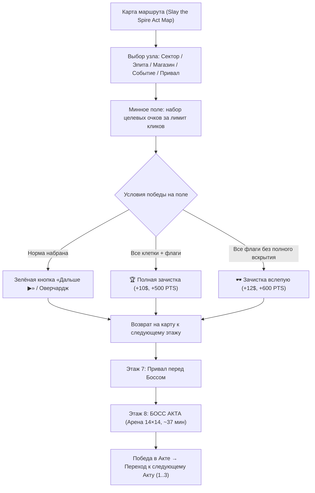

# 2. Игровой цикл (Core Loop)

## Структура забега

Забег состоит из **3 Актов** (Уровней), каждый Акт содержит **8 Секторов (Этажей)**, отображаемых в строке состояния как `Уровень-Сектор/8` (`1-1/8` .. `1-8/8`):

| Этаж / Сектор | Тип узла | Описание |
|---|---|---|
| **Этаж 0 (1/8)** | ⚔️ Стартовый сектор | Точка входа в Акт, базовое поле $10\times10$ |
| **Этажи 1–4 (2/8–5/8)** | Ветвящиеся маршруты | Развилки: ⚔️ Обычные секторы, 💀 Элитные секторы (+3 мины, $+3$), 🛒 Торговые посты, ❓ Аномалии/События |
| **Этаж 5 (6/8)** | Предфинальные развилки | Усиленные секторы перед подготовкой к боссу |
| **Этаж 6 (7/8)** | 🏕️ Привал (Rest Site) | Гарантированная стоянка: починка корпуса (+1 HP) или апгрейд |
| **Этаж 7 (8/8)** | 👑 БОСС АКТА | Финальный сервер сектора: **Арена $14\times14$ (196 клеток, ~37 мин, 33 клика)** |

## Механика победы и завершения сектора

1. **Достижение планки очков (`Score Target`):**
   - На экране загорается кнопка **«Дальше ▶»**.
   - Автоматического принудительного перехода нет — игрок может продолжить игру на поле ради **Overcharge** ($+1\$$ за каждые $+50\%$ очков сверх нормы) или бонусов зачистки.
   - **Риск:** если после достижения нормы игрок подрывается и теряет все HP — раунд проигран (забег окончен).
2. **Специальные условия завершения:**
   - **🏆 Полная зачистка (Full Clear):** Открыты все безопасные клетки и помечены все мины $\to$ $+10\$$, $+500\text{ PTS}$.
   - **🕶️ Зачистка вслепую (Blind Clear):** Все мины верно размечены, но часть безопасных клеток осталась скрыта $\to$ $+12\$$, $+600\text{ PTS}$.
   - **🕵️ Античит (Детектор жуликов):** Быстрое прокликивание флагов наугад без логических ориентиров детектируется как жульничество $\to$ штраф $-500\text{ PTS}$, статус «Жулик» и наложение дебафа **«Половина флагов»** на следующий уровень.

## Механика «Флаг-Слот 🎰» (3-Reel Slot Flag Machine)

Заменила старый рычаг детонатора на компактный портативный расходник `CON-SLOT` (3 заряда):
1. **Установка:** Игрок расставляет до 3 специальных флагов-слотов (отображаются со слотовыми пипами 1/3, 2/3, 3/3). Снятие флага возвращает заряд.
2. **Авто-ролл:** При установке 3-го флага-слота по периметру поля загорается аркадная гирлянда, и запускается прокрутка 3 вертикальных слотовых барабанов под ритмичный саспенс.
3. **Результат:**
   - **7-7-7 ДЖЕКПОТ (все 3 клетки — мины):** Все 3 мины обезвреживаются, безопасные клетки вокруг каскадно вскрываются, начисляется $+150\%$ от целевых очков сектора, $+3$ Bits, комбо $+3$.
   - **Сбой (не все 3 клетки — мины):** Правильно угаданные мины сохраняются как подтверждённые флаги, безопасные клетки открываются, штраф $-1$ HP, комбо сбрасывается, но потраченный клик батареи компенсируется.
