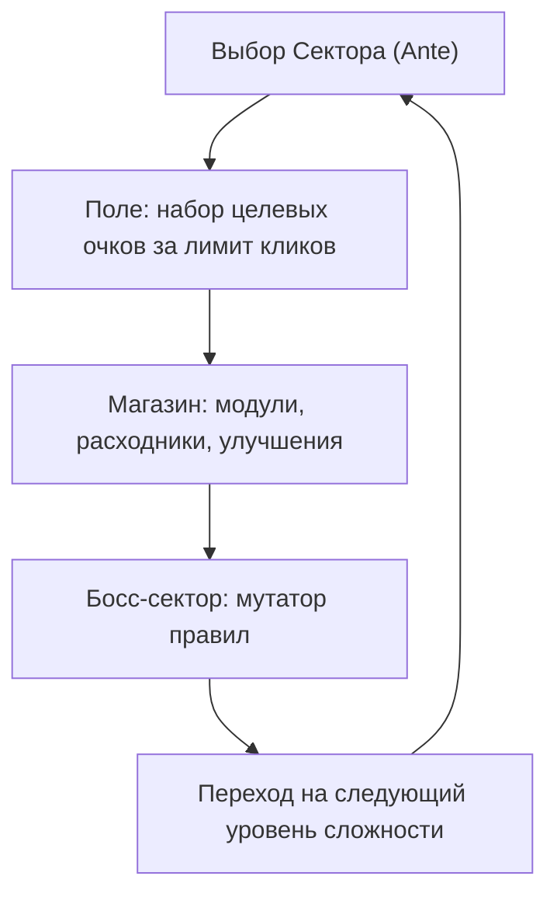

# 2. Игровой цикл (Core Loop)

## Структура забега

Забег = **8 Глубин (Sectors)**. Каждая Глубина = 3 этапа:

| # | Этап | Описание |
|---|---|---|
| 1 | Стандартный сканер | Базовая планка очков |
| 2 | Глубокий сканер | Повышенная планка, больше мин |
| 3 | Аномалия / Босс | Высокая планка + глобальный мутатор ([боссы](../content/bosses.md)) |
