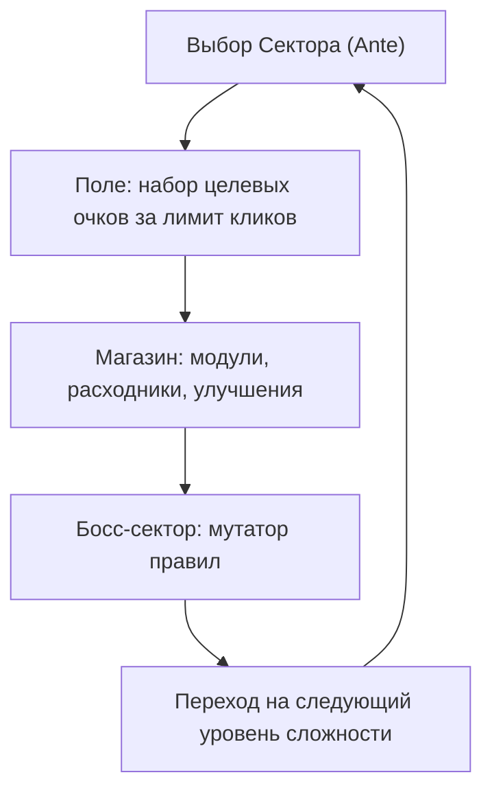

# 2. Игровой цикл (Core Loop)

## Структура забега

Забег = **8 Глубин (Sectors)**. Каждая Глубина = 3 этапа:

| # | Этап | Описание |
|---|---|---|
| 1 | Стандартный сканер | Базовая планка очков |
| 2 | Глубокий сканер | Повышенная планка, больше мин |
| 3 | Аномалия / Босс | Высокая планка + глобальный мутатор ([боссы](../content/bosses.md)) |

## Механика Рубильника Детонатора (The Cashout Lever)

Рядом с полем расположен массивный механический рубильник детонатора — центральная механика управления риском (Press-Your-Luck).

1. **Фаза ставки:** Игрок расставляет флаги на предполагаемые мины. Каждый выставленный флаг увеличивает множитель и потенциальный куш (`Jackpot Multiplier`).
2. **Дергаем рычаг:** Игрок фиксирует ставку и нажимает рубильник. Поле блокируется на время валидации.
3. **Последовательная валидация (The Roll):** Система по очереди проверяет флаги под нарастающий ритм барабанов саспенса (`Тум... Тум... Тум...`).
4. **Результат:**
   - **Джекпот (все флаги верны):** Все помеченные мины красиво деактивируются без урона. Начисляется гигантский куш очков с учётом накопленного множителя, открываются безопасные клетки вокруг детонации, комбо вырастает, а за смелые ставки ($\ge 3$ флага) начисляются Bits.
   - **Осечка (хотя бы один ложный флаг):** При обнаружении первой же безопасной клетки раздаётся сирена аварии, игрок теряет 1 HP, комбо-множитель сбрасывается в 0, а ставка сгорает.
